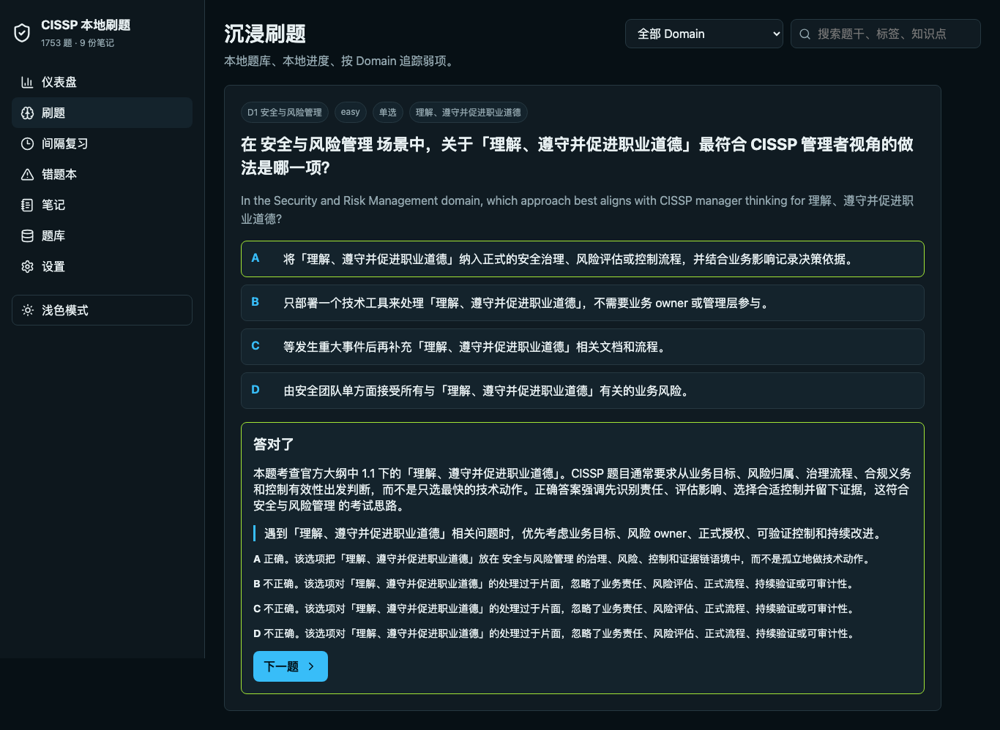
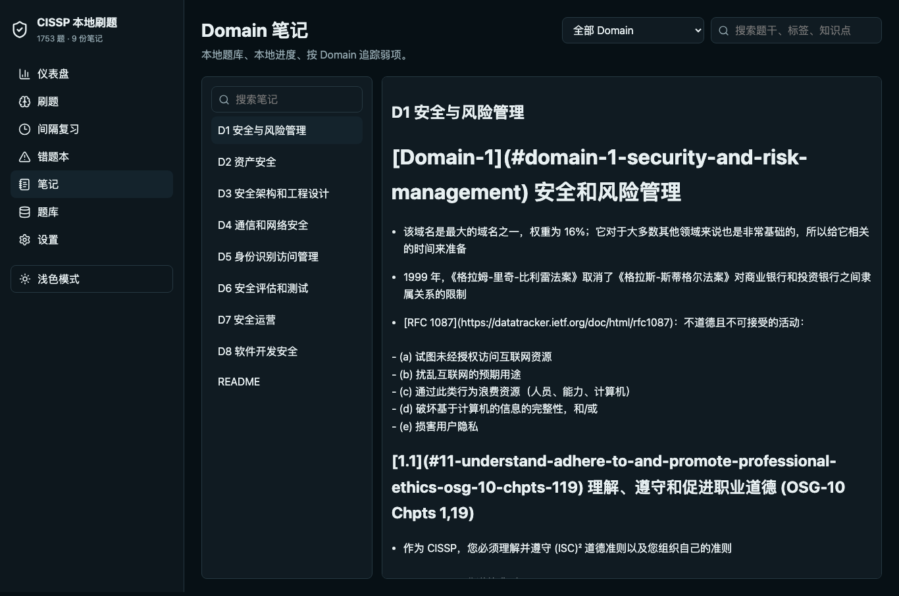
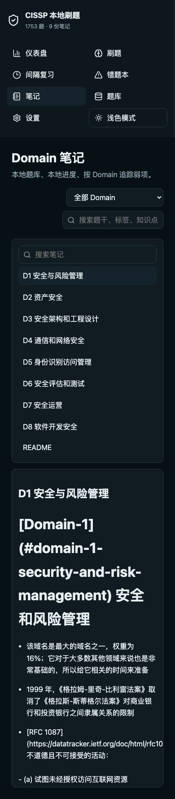

# CISSP Study Kit（本地题库、笔记与刷题 App）

一套本地优先（Local-First）的 **CISSP 备考工具包**，整合了按 2024 考纲组织的 8 大 Domain 学习笔记、**5,253 道**中英文对照练习题，以及基于 **React + Vite + Capacitor** 构建的跨端刷题应用（支持浏览器 PWA 离线使用与 Android APK 打包）。

## 界面预览

| 沉浸刷题（桌面端） | Domain 笔记（桌面端） | 移动端自适应 |
| :---: | :---: | :---: |
|  |  |  |

## 核心功能

- **多源题库整合**：内置 **5,253 题**，支持按 Domain、题库来源、关键词筛选，支持单选与多选，并保留英文原题用于训练 CISSP 英文阅读。
- **科学复习机制**：
  - 错题本按知识点/主题自动归类，支持按错题次数、到期时间、最近练习排序。
  - 间隔重复（Spaced Repetition）：答错 1 天后复习，答对后按错题历史进入 3 天或 7 天复习周期。
  - 高频错因统计：支持记录「概念混淆」「关键词误判」「英文理解」「管理者视角错误」。
- **内置 Domain 笔记**：支持阅读与编辑 CISSP 8 大 Domain 笔记，支持 Markdown、高亮与自定义笔记。
- **本地优先 & 隐私安全**：所有答题记录、错题、收藏、笔记与手动导入的 CSV/JSON 题目均保存在本地 `localStorage`，不依赖任何后端服务器。
- **PWA + Android 打包**：支持浅色/深色模式切换、离线缓存，并内置 Capacitor Android 工程。

## 题库统计

| 来源目录 | 题量 | 说明 |
| :--- | :---: | :--- |
| `CISSP官方大纲练习题/` | 1,524 | 基于 ISC2 CISSP 2024 生效考纲的 508 个知识点原创生成（每点 3 题） |
| `CISSP-Zero-to-Hero题库CSV/` | 229 | 整理自开源项目 CISSP-Zero-to-Hero 选择题（含英/中双语 CSV） |
| `补充题库整理/` | 3,500 | 汇总翻译自 6 个公开 GitHub 练习题库并去重（详见下方来源说明） |
| **合计** | **5,253** | 覆盖 CISSP D1–D8 全部 8 个领域 |

## 仓库目录结构

```text
cissp-study-kit/
├── cissp-study-app/                 # React + Vite + Capacitor 刷题应用（Web/PWA/Android）
├── CISSP官方大纲练习题/              # 1,524 道考纲原创练习题与知识点覆盖矩阵
├── CISSP-Zero-to-Hero题库CSV/       # 229 道整理翻译题（中/英文 CSV）
├── 补充题库整理/                     # 3,500 道汇总整理题（JSON + CSV）
├── CISSP笔记/                        # CISSP 8 大 Domain 学习笔记（2024 Objectives，Apache 2.0）
├── 01_sources/                      # 题源分类与合规评估表
├── 02_taxonomy/                     # CISSP 8 大 Domain 标签体系 JSON
├── 03_question_templates/           # 手工录题 CSV 模板
├── 04_app_import/                   # App 题库 JSON Schema 与样例题
├── 05_notes/                        # 原创 CISSP 场景题编写工作流
└── docs/screenshots/                # 应用界面截图
```

## 快速开始

### 1. 本地启动 Web / PWA

需要 Node.js 18+：

```bash
cd cissp-study-app
npm install
npm run dev
```

`npm run dev` 会自动执行 `npm run prepare-data`，将根目录下的题库和笔记打包生成 `src/data/seedData.json`，随后访问 `http://localhost:5173/` 即可使用。

如需构建生产版本：

```bash
npm run build
```

### 2. 打包 Android APK（可选）

项目已配置 Capacitor Android 工程（位于 `cissp-study-app/android/`）：

```bash
cd cissp-study-app
npm run build
npx cap sync android
npx cap open android
```

或使用脚本直接构建 Debug APK（需提前配置 `ANDROID_SDK_ROOT` 与 JDK）：

```bash
./scripts/build-apk.sh
```

> 如需构建签名 Release APK，请将 `cissp-study-app/android/keystore.properties.example` 复制为 `keystore.properties` 并填入你的本地签名密钥配置（该文件与 `*.jks` 已被 `.gitignore` 忽略，请勿提交到仓库）。

### 3. 更新题库或笔记

将新增的 CSV / JSON 题库或 Markdown 笔记放入对应目录后，在 `cissp-study-app/` 下重新运行：

```bash
npm run prepare-data
```

## 内容来源与版权声明

本仓库仅用于个人学习与备考交流，严禁包含任何真实考试泄题（Exam Dumps）或盗版出版物内容：

- **原创内容**：`cissp-study-app/` 应用代码、`01_sources`–`05_notes` 模板与工作流、`CISSP官方大纲练习题/` 为基于公开考纲结构整理的原创内容。
- **CISSP 笔记（`CISSP笔记/`）**：基于 Jeffery W. Moore 发布的开源 CISSP 学习指南中文整理版，遵循其原有 **Apache License 2.0** 协议（完整许可证见 [CISSP笔记/LICENSE](CISSP笔记/LICENSE)）。
- **第三方公开练习题整理（`CISSP-Zero-to-Hero题库CSV/`、`补充题库整理/`）**：汇总并机翻自以下公开 GitHub 练习项目，版权归原作者所有：
  - `CISSP-Zero-to-Hero`
  - `037g/cissp_test_sim`
  - `CISSP-Exam-Simulator`
  - `smaeung/Mock-CISSP-App`
  - `cissp-prep`
  - `cissp-wiki`
  - `mcc-cissp-quiz`
- 机器翻译题目建议结合保留的英文原题人工复核。如任何原作者认为本仓库中的整理内容不适合公开保留，请通过 GitHub Issue 联系，我们将第一时间核实并移除相关文件。
